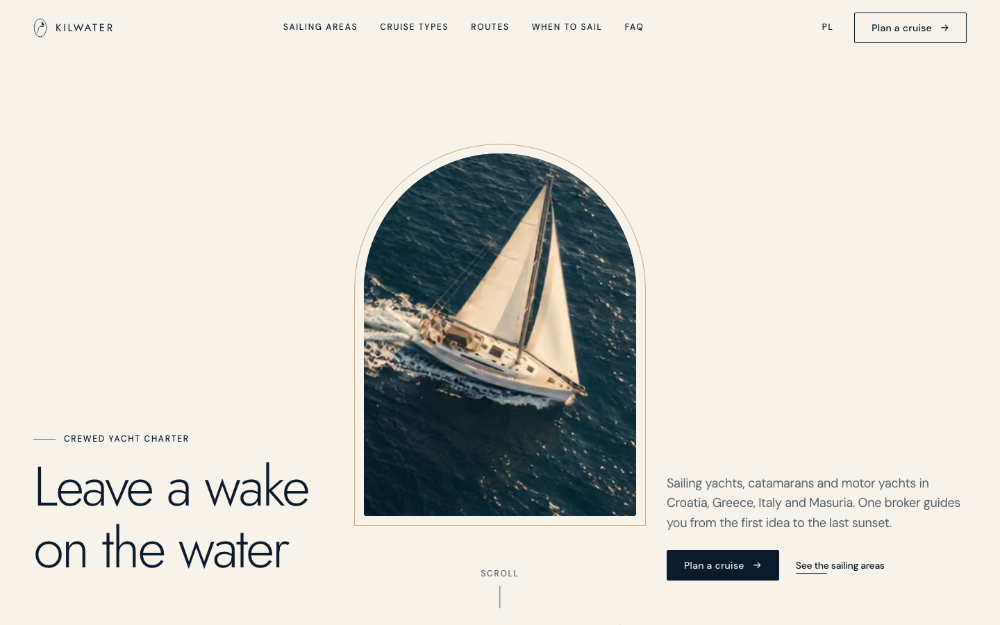
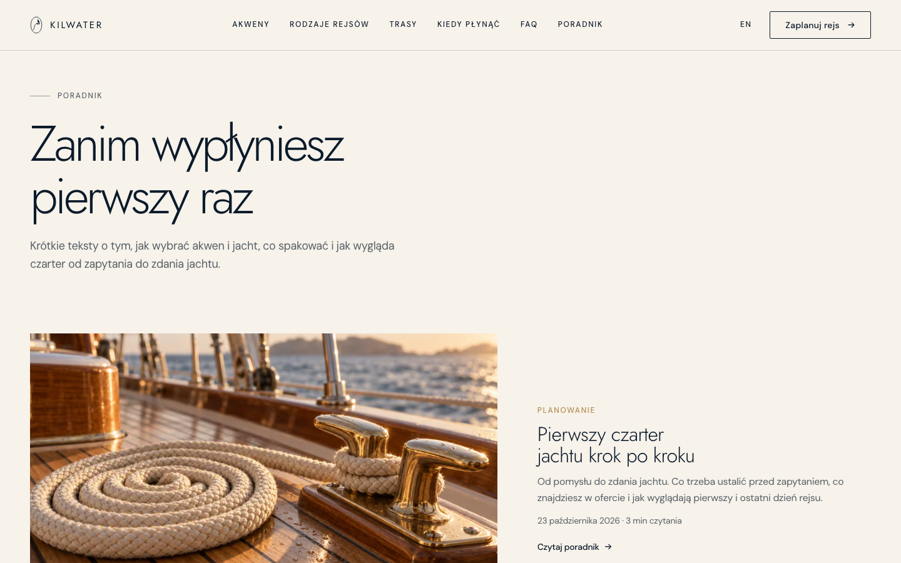
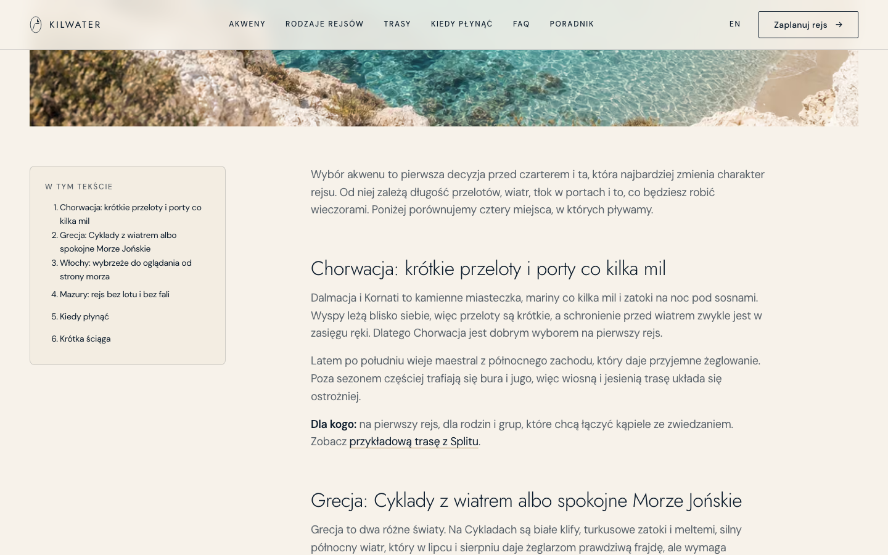
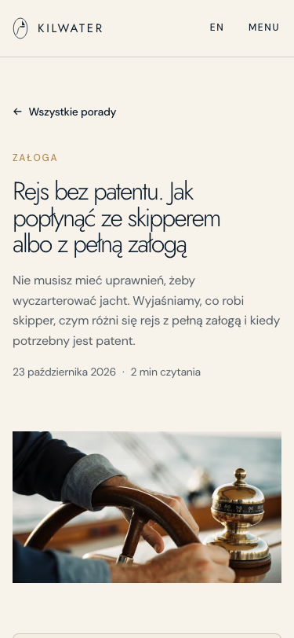

# Kilwater

[Polski](README.md) · **English**

> Leave a trace on the water.

Kilwater is a landing page for a Polish crewed yacht charter brand. The page leads through four sailing areas
(Croatia, Greece, Italy, the Masurian Lakes), three types of cruises, the crew and extras, and ends with an enquiry
form that goes straight to the broker. The name is the sailing word for the trail a yacht leaves on the water (Polish
*kilwater*, wake), and that motif runs through the whole page: from the hero, through a brass wave line drawn on scroll,
to the lettering in the footer.

It is Astro 7 with static HTML and a single endpoint on a Node server. Motion is done with GSAP and Lenis, fonts are
self-hosted, and the form validates data twice: in the browser and on the server (zod).

The site is in Polish.


## Who it is for

- **A charter company or yacht broker** that sells through conversation, not a shopping cart. The client describes
  the cruise in a few fields, the broker gets all the information by email and replies with a yacht proposal.
- **Developers and agencies** looking for a pattern for a premium landing page without a ready template: arched
  frames, scrollytelling, a form validated on both sides, e2e tests and documentation.

It is not a booking system: there is no yacht catalog, availability calendar, payments or client accounts. The page
collects enquiries, and the booking happens in a conversation with the broker.

## How it works

```
Browser ──► Node server (@astrojs/node)
              │
              ├──► static pages from the build: /, /polityka-prywatnosci, /regulamin, 404
              ├──► /sitemap.xml, /robots.txt, favicon, OG image
              └──► POST /api/zapytanie ──► zod validation ──► Resend ──► broker's inbox
                                                              └─► server log (test mode)
```

**Pages** are built to static HTML. Photos go through `astro:assets` and reach the browser as AVIF and WebP in several
widths, with JPG as a fallback. Only the form endpoint runs on the server.

**An enquiry** goes like this:

1. The client fills in the form in the "Plan a cruise" section: sailing area, date, length, number of people, cruise
   type, extras, contact details and acceptance of the terms. The "Ask about a cruise" link next to an area sets the
   area right away.
2. The browser checks the fields and on an error shows a message under the field saying what to fix.
3. `POST /api/zapytanie` checks the content type and size, a limit of 5 enquiries per 10 minutes per IP, a bot trap and
   every field. Extra fields, e.g. `isAdmin`, are rejected.
4. The server sends the broker a plain text email through Resend, with the client's address in Reply-To.
5. The client sees a confirmation with their name.

Without Resend configured the enquiry goes to the server log (in `npm run dev` and with `INQUIRY_DRY_RUN=1`). In
production without configuration the endpoint returns `503`, so enquiries don't get lost silently.

## Features

**Paths**

| Path | What it is |
|---|---|
| `/` | Landing: hero, what Kilwater is, sailing areas, cruise types, crew and extras, sample routes, season calendar, how it works, FAQ, form |
| `/en/` | English version of the landing page with the same sections, form and assistant |
| `/poradnik` | Guide: a list of articles before the first cruise (in Polish) |
| `/poradnik/<article>` | Article with contents, a call to action and related texts |
| `/polityka-prywatnosci` | GDPR-compliant privacy policy with a table of contents (`/en/privacy-policy` in English) |
| `/regulamin` | Website terms under the Polish electronic services act (`/en/terms` in English) |
| any other path | 404 page "This course leads straight into the fog" |
| `POST /api/zapytanie` | Receiving a cruise enquiry |
| `POST /api/asystent` | The assistant's answer to a cruise question (`GET` loads the model ahead of time) |
| `/sitemap.xml`, `/robots.txt` | Sitemap and crawler rules |

**Landing**

- **Hero** - a yacht in an arched window with a brass rim. On scroll the window grows to full screen and reveals the
  KILWATER mark.
- **Wave line** - a brass line draws itself with the scroll through the following sections, with a small yacht sailing
  at its head. On phones it crosses from side to side behind the photos.
- **Sailing areas** - four frames in a 1-2-1 layout, with parallax and links that set the area in the form.
- **Cruise types** - a navy section with a sticky photo that changes as you scroll.
- **Sample routes** - four one-week loops (Split, the Cyclades, Amalfi, Masuria) in tabs, on a real OpenStreetMap map:
  coastlines, islands, lakes and canals. The route follows the water (found automatically when the data is built),
  draws itself when the section comes into view, and hovering a day highlights that leg and its ports. The "Zapytaj o tę trasę" button
  sets the area and writes the route into the form message.
- **Season calendar** - a table of sailing areas and months from April to October. Clicking a cell shows what to
  expect, the wind and the water temperature, and the button sets the area and the first Saturday of that month in
  the form.
- **How it works** - four steps on a timeline that fills in on scroll.
- **FAQ** - ten questions in collapsible `details` sections, with `FAQPage` structured data.
- **Assistant** - an "Ask the assistant" box next to the FAQ. A local `bge-m3` model on the server compares the meaning
  of the question with a base of typical questions and shows a ready Kilwater answer. When it does not know, it points
  to email.
- **Form** - choice cards, a people stepper, a character counter, a Ctrl/⌘ + Enter shortcut, error, sending and
  success states.
- **Footer** - an invitation with a "Zaplanuj swój rejs" button, a note that the enquiry costs nothing and shortcuts to
  the sailing areas that set the area in the form right away. The KILWATER letters rise from the water as the yacht
  sails under them.

**English version**

- `/en/…` paths, a PL/EN switch in the menu that leads to the counterpart of the current page, and `hreflang` plus the
  sitemap pointing to both versions.
- Interface texts live in `src/i18n/ui.ts` (the Polish dictionary is the template and TypeScript requires English to
  have the same keys), content in `src/data/*` as `{ pl, en }` pairs.
- The form and the assistant send a `lang` field, so error messages and assistant answers are in the page language.
  The email to the broker stays in Polish with a note about the client's language.
- The English legal documents are an informational translation. The Polish version is binding.

**Guide**

- Five Markdown articles (`src/content/poradnik/`): first charter step by step, choosing an area, yacht types, what
  to pack and sailing without a licence. Content based on the site data and general sailing knowledge, with no
  prices or promises.
- A 1-2-2 list with cards of different sizes, an article page with contents, reading time, `Article` and
  `BreadcrumbList` structured data, a call to action and two related texts.
- The assistant knows every article and links to it for matching questions. An e2e test makes sure a new article
  is never left without an answer in the assistant base.

All animations turn off with `prefers-reduced-motion`. The page then shows the final state right away.

## Screenshots

### Desktop

| Sailing areas | Greece and Italy |
|---|---|
|  |  |

| Cruise types | Extras on board |
|---|---|
|  |  |

| Sample routes | Season calendar |
|---|---|
|  |  |

| FAQ and assistant | English version |
|---|---|
|  |  |

| Guide | Article |
|---|---|
|  |  |

| How it works | Footer |
|---|---|
|  |  |

| Enquiry form | Form with errors |
|---|---|
|  |  |

| 404 page | Privacy policy |
|---|---|
|  |  |

### Phone

| Hero | Menu |
|---|---|
|  |  |

| Route | Guide article |
|---|---|
|  |  |

The screenshots show the final state of the animations. The form data is
sample data.

## Getting started

Requires Node.js 22.23.4 or newer (an Astro 7 requirement).

```bash
npm install
npm run assistant:model  # once: the assistant model, about 560 MB into models/
npm run dev              # http://localhost:4520
```

Production version:

```bash
npm run build
HOST=0.0.0.0 PORT=8080 node ./dist/server/entry.mjs
```

| Script | What it does |
|---|---|
| `npm run dev` | Dev server on port 4520. Form enquiries go to the log |
| `npm run build` | Build: static pages in `dist/client`, the server in `dist/server` |
| `npm run preview` | Build preview |
| `npm run assistant:model` | Downloads the assistant model `Xenova/bge-m3` into `models/` (once, also on deployment) |
| `npm run check` | TypeScript check of `.astro` and `.ts` files (`astro check`) |
| `npm run test:e2e` | 51 Playwright tests on the production build (port 4521) |
| `npm run assistant:eval` | 67 check questions in Polish and English: paraphrases of the base, near-topic questions without an answer, off-topic questions and the contact data filter |
| `npm run brand:assets` | Generates the favicon (`.ico`, `.svg`, Apple icon) and a 1200x630 OG image from the logo mark |
| `npm run routes:map` | Downloads coastlines, lakes and canals for the routes from OpenStreetMap, finds the water route and writes `src/data/route-maps.json` |
| `npm run images:strip` | Removes metadata (EXIF, XMP, C2PA) from images in `src/assets/photos`, `public` and `docs/screenshots` |

Astro 7 allows one dev server per project, so the tests build the production version and run it on a separate port.

## Configuration

Variables in `.env` (template in `.env.example`, `.env` itself is in `.gitignore`).

| Variable | Description |
|---|---|
| `RESEND_API_KEY` | Resend API key. Server only |
| `INQUIRY_TO_EMAIL` | The address enquiries go to, e.g. `kontakt@kilwater.com` |
| `INQUIRY_FROM_EMAIL` | A sender verified in Resend, e.g. `Kilwater <zapytania@kilwater.com>` |
| `INQUIRY_DRY_RUN` | `1` = the enquiry goes only to the server log. For testing, never in production |
| `ASSISTANT_RATE_LIMIT` | Assistant questions per 10 minutes from one IP address, 20 by default |
| `HOST`, `PORT` | Production server address and port |

The site address for canonical, Open Graph and the sitemap is set by `site` in `astro.config.mjs`
(`https://kilwater.com`). Company details in the footer and form are in `src/data/company.ts`.

### Assistant (local model)

The assistant uses no paid API. The `Xenova/bge-m3` model (about 560 MB, MIT license) runs inside the Node process
through `@huggingface/transformers` and ONNX Runtime, without a GPU.

1. Download the model: `npm run assistant:model`. The files go to `models/` (in `.gitignore`), so run the command
   once on the server at deployment. At runtime the server downloads nothing from the internet.
2. Start the server from the project directory, because the model is looked up in `./models`.
3. Memory: the process with the model loaded takes about 1 GB of RAM, so a 2 GB server is enough. The first question
   after start loads the model for a few seconds. The page triggers this earlier, when someone gets close to the FAQ.
   Later answers take tens of milliseconds.

How it works:

| Step | What it does |
|---|---|
| Server filter | Rejects empty and too long questions, links, emails and phone numbers |
| Knowledge base | `src/data/assistant-answers.ts`: the FAQ with typical phrasings (`alsoAsked` in `faq.ts`) and answers built from the site data: sailing areas, season, routes, cruise types, crew, extras, contact |
| Matching | The model turns the question into a vector and compares it with every phrasing in the base |
| Answer | A ready answer and a link when similarity is at least 0.80, or at least 0.70 with a 0.04 lead over the next answer. Otherwise from 0.64: "no confident answer" with similar questions. Below: a pointer to email with the question prefilled |

The assistant never writes its own sentences, it only shows texts from the base, so it cannot be used for other
topics. To teach it a new question, add a phrasing to `alsoAsked` or a new entry in `assistant-answers.ts` and run
`npm run assistant:eval`.

### Sending email (Resend)

1. Create an account at [resend.com](https://resend.com) and verify the `kilwater.com` domain (DNS records).
2. Create an API key with sending permission only.
3. Fill in `RESEND_API_KEY`, `INQUIRY_TO_EMAIL` and `INQUIRY_FROM_EMAIL` in `.env` on the server.
4. Send an enquiry from the form and check the inbox.

## Structure

```
src/
  pages/            index, 404, polityka-prywatnosci.md, regulamin.md, sitemap.xml.ts,
                    en/ (index, privacy-policy.md, terms.md), poradnik/ (index, [slug])
  pages/api/        zapytanie.ts - the form endpoint, asystent.ts - the assistant endpoint
  components/       landing sections (Hero, Destinations, CruiseTypes, CrewExtras, SampleRoutes,
                    SeasonCalendar, Process, Faq, Inquiry),
                    HomePage (shared PL and EN home page), Voyage (wave line), Nav, Footer, Logo, LineIcon
  content/poradnik/ guide articles in Markdown (schema in src/content.config.ts)
  i18n/             locales.ts (languages and paths), ui.ts (interface texts), inquiry-messages.ts (form messages)
  layouts/          Base (meta, navigation, footer), LegalLayout (documents with a table of contents)
  data/             company.ts, inquiry-options.ts, logo-mark.ts - a single source of data and the logo mark,
                    offer.ts, routes.ts, seasons.ts, faq.ts - offer, routes, season calendar and FAQ content,
                    route-maps.json - route maps from OpenStreetMap (generated by npm run routes:map),
                    assistant-answers.ts - the assistant's answer base
  lib/              inquiry-schema.ts - zod validation, assistant.ts - local model and question matching,
                    guide.ts - guide articles, env.ts, rate-limit.ts
  scripts/          motion.ts (GSAP, Lenis, anchors), reveal.ts (reveals and parallax)
  styles/           tokens.css (colors, typography, spacing), global.css
  assets/photos/    source photos, optimized at build time
public/             favicon, apple-touch-icon, og-image.jpg, robots.txt
scripts/            brand-assets.mjs, strip-image-metadata.mjs, download-assistant-model.mjs,
                    build-route-maps.mjs
tests/e2e/          form, API, pages and SEO, navigation, routes, season, FAQ, assistant, English version, guide
tests/eval/         assistant answer quality checks
models/             assistant model downloaded by npm run assistant:model (outside the repository)
docs/
  api-documentation.pdf / .html   endpoint documentation
  screenshots/                    screenshots used in the README
```

## Security

- Every field is validated on the server (zod `strictObject`), even when the browser already checked it. The server
  accepts only known fields and takes nothing from the client apart from the enquiry content.
- A limit of 5 enquiries per 10 minutes per IP, a 10,000 byte content limit, a required
  `Content-Type: application/json`.
- A bot trap (`website`): a bot gets `200`, and the enquiry is not processed.
- The email to the broker is plain text, with no HTML from client data. API responses contain no error details or
  stack traces.
- The Resend key lives only in `.env` on the server. No secret, answer base or model reaches the browser, which an
  e2e test checks.
- Assistant: questions are processed only on the server, the answer is rendered as text (`textContent`), the logs
  hold only the answer type, never the question. A limit of 20 questions per 10 minutes per IP protects the CPU.
- Images have no metadata (EXIF, XMP, C2PA). AI agent files, keys and certificates are in `.gitignore`.

To do at deployment: security headers (CSP, HSTS, `Referrer-Policy`, `Permissions-Policy`, `frame-ancestors`) on the
hosting and Cloudflare Turnstile on the form. The rate limit is counted in process memory, so with several server
instances it has to move to a shared store (e.g. Redis).

## Performance

The home page is static HTML (12 KB gzipped), 8 KB of CSS and 54 KB of JavaScript gzipped, most of it GSAP and Lenis.
Photos are served as AVIF and WebP through `srcset`, and below the first screen they load lazily. The hero photo is
24-81 KB in AVIF instead of 2 MB in PNG. The Jost and DM Sans fonts are self-hosted (no Google Fonts), and the heading
font is preloaded.

## Photos and licenses - before publishing

All photos are AI-generated (ElevenLabs with the gpt-image-2.5 model, Gamma and FLUX.1 Krea on Hugging Face). They
don't show real yachts or people. The C2PA provenance metadata was removed. Since August 2026 the EU AI Act (Art. 50)
requires labeling realistic AI-generated content that depicts real places. Before publishing, check this with a lawyer
or replace the photos with real photos of yachts.

The Jost and DM Sans fonts are under the SIL Open Font License, so they can be used commercially.

The `/polityka-prywatnosci` and `/regulamin` documents are templates. Before publishing, fill in the `[[...]]` fields
(KRS, registry court, share capital, hosting, accounting office, retention periods, effective date) and have a lawyer
review them. The company details in the current version are sample data.

Route maps are built from data © OpenStreetMap contributors under the ODbL. The credit with a link to
openstreetmap.org/copyright sits under every map and must stay. `src/data/route-maps.json` is a derived database,
so it falls under the ODbL rather than the code's MIT license. The maps are inlined in the page, so the browser
connects to no map server. To refresh the data or add a route, run `npm run routes:map` (public Overpass servers
are often busy, the script retries on its own, and `OSM_CACHE_DIR=<folder>` stores responses for reuse).

## Documentation

- [`docs/api-documentation.pdf`](docs/api-documentation.pdf) - the `POST /api/zapytanie` endpoint: fields, values,
  request and response examples, error codes, email sending (Polish).
- [`docs/api-documentation.html`](docs/api-documentation.html) - the same documentation in HTML.

## License

[MIT](LICENSE) © 2026 Szymon Kaczmarczyk
