# Kilwater

**Polski** · [English](README.en.md)

> Zostaw ślad na wodzie.

Kilwater to landing polskiej marki czarteru jachtów z załogą. Strona prowadzi przez cztery akweny (Chorwacja,
Grecja, Włochy, Mazury), trzy rodzaje rejsów, załogę i dodatki, a kończy się formularzem zapytania, które trafia
prosto do brokera. Nazwa to żeglarskie słowo na ślad, który jacht zostawia na wodzie, i ten motyw prowadzi całą
stronę: od hero, przez mosiężną linię fali rysowaną przy przewijaniu, po napis w stopce.

Całość to Astro 7 ze statycznym HTML-em i jednym endpointem na serwerze Node. Ruch robią GSAP i Lenis, fonty
są hostowane lokalnie, a formularz sprawdza dane dwa razy: w przeglądarce i na serwerze (zod).

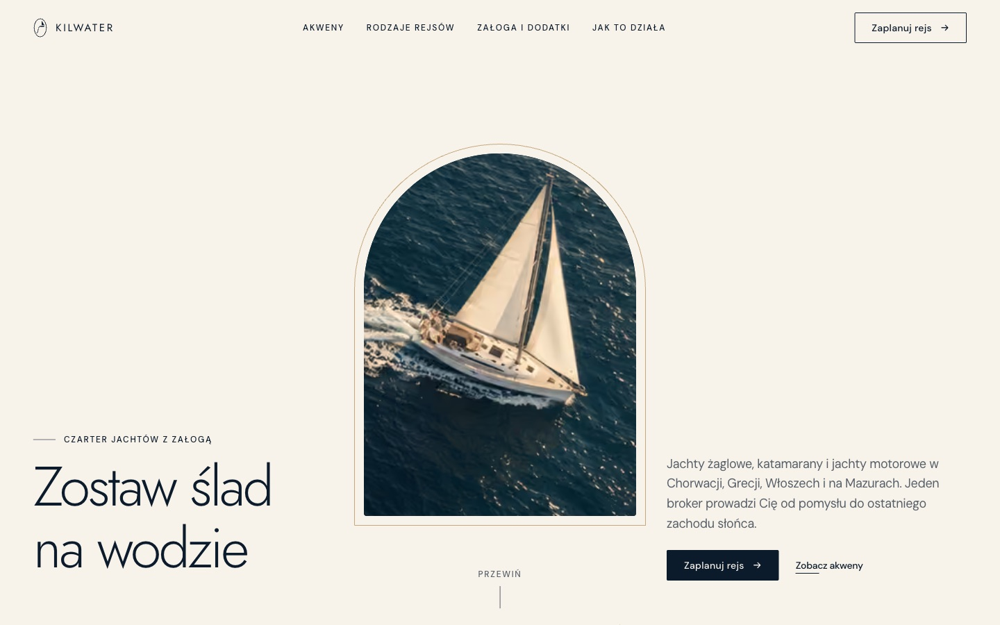

## Dla kogo

- **Dla firmy czarterowej albo brokera jachtów**, który sprzedaje przez rozmowę, a nie przez koszyk. Klient
  opisuje rejs w kilku polach, broker dostaje komplet informacji mailem i odpisuje z propozycją jachtów.
- **Dla deweloperów i agencji**, którzy szukają wzoru landingu premium bez gotowego szablonu: łukowe kadry,
  scrollytelling, formularz z walidacją po obu stronach, testy e2e i dokumentacja.

Nie jest to system rezerwacyjny: nie ma katalogu jachtów, kalendarza dostępności, płatności ani kont klientów.
Strona zbiera zapytania, a rezerwacja odbywa się w rozmowie z brokerem.

## Jak to działa

```
Przeglądarka ──► serwer Node (@astrojs/node)
                   │
                   ├──► statyczne strony z buildu: /, /polityka-prywatnosci, /regulamin, 404
                   ├──► /sitemap.xml, /robots.txt, favicon, obraz OG
                   └──► POST /api/zapytanie ──► walidacja zod ──► Resend ──► skrzynka brokera
                                                                   └─► log serwera (tryb testowy)
```

**Strony** są budowane do statycznego HTML-a. Zdjęcia przechodzą przez `astro:assets` i trafiają do
przeglądarki jako AVIF i WebP w kilku szerokościach, z JPG jako zapasem. Na serwerze działa tylko endpoint
formularza.

**Zapytanie** przechodzi taką drogę:

1. Klient wypełnia formularz w sekcji „Zaplanuj rejs”: akwen, data, długość, liczba osób, rodzaj rejsu,
   dodatki, kontakt i akceptacja regulaminu. Link „Zapytaj o rejs” przy akwenie od razu ustawia akwen.
2. Przeglądarka sprawdza pola i przy błędzie pokazuje pod polem komunikat z informacją, co poprawić.
3. `POST /api/zapytanie` sprawdza typ i rozmiar treści, limit 5 zapytań na 10 minut z jednego IP, pułapkę
   na boty i każde pole. Nadmiarowe pola, np. `isAdmin`, są odrzucane.
4. Serwer wysyła brokerowi e-mail tekstowy przez Resend, z adresem klienta w Reply-To.
5. Klient widzi potwierdzenie ze swoim imieniem.

Bez konfiguracji Resend zapytanie trafia do logu serwera (w `npm run dev` i przy `INQUIRY_DRY_RUN=1`). Na
produkcji bez konfiguracji endpoint zwraca `503`, żeby zapytania nie ginęły po cichu.

## Funkcje

**Adresy**

| Adres | Co to jest |
|---|---|
| `/` | Landing: hero, czym jest Kilwater, akweny, rodzaje rejsów, załoga i dodatki, przykładowe trasy, kalendarz sezonu, jak to działa, FAQ, formularz |
| `/polityka-prywatnosci` | Polityka prywatności zgodna z RODO, ze spisem treści |
| `/regulamin` | Regulamin serwisu według ustawy o świadczeniu usług drogą elektroniczną |
| każdy inny adres | Strona 404 „Ten kurs prowadzi prosto we mgłę” |
| `POST /api/zapytanie` | Przyjęcie zapytania o rejs |
| `POST /api/asystent` | Odpowiedź asystenta na pytanie o rejs (`GET` wczytuje model z wyprzedzeniem) |
| `/sitemap.xml`, `/robots.txt` | Mapa strony i zasady dla robotów |

**Landing**

- **Hero** - jacht w łukowym oknie z mosiężną obwódką. Przy przewijaniu okno rośnie do pełnego ekranu
  i odsłania znak KILWATER.
- **Linia fali** - mosiężna linia rysuje się za przewijaniem przez kolejne sekcje, a na jej czele płynie
  mały jacht. Na telefonie przechodzi z boku na bok za zdjęciami.
- **Akweny** - cztery kadry w układzie 1-2-1, z paralaksą i linkami ustawiającymi akwen w formularzu.
- **Rodzaje rejsów** - granatowa sekcja z przyklejonym zdjęciem, które zmienia się przy przewijaniu.
- **Przykładowe trasy** - cztery tygodniowe pętle (Split, Cyklady, Amalfi, Mazury) w zakładkach. Mapa
  w SVG rysuje się po wejściu w sekcję, a najechanie na dzień planu podświetla odcinek i porty.
  Przycisk „Zapytaj o tę trasę” ustawia akwen i wpisuje trasę do wiadomości w formularzu.
- **Kalendarz sezonu** - tabela akwenów i miesięcy od kwietnia do października. Kliknięcie pola pokazuje
  opis terminu, wiatr i temperaturę wody, a przycisk ustawia akwen i pierwszą sobotę miesiąca w formularzu.
- **Jak to działa** - cztery kroki na osi czasu wypełnianej przy przewijaniu.
- **FAQ** - dziesięć pytań w rozwijanych sekcjach `details`, z danymi strukturalnymi `FAQPage`.
- **Asystent** - okno „Zapytaj asystenta” obok FAQ. Lokalny model `bge-m3` na serwerze porównuje sens pytania
  z bazą typowych pytań i pokazuje gotową odpowiedź Kilwater. Gdy jej nie zna, odsyła na e-mail.
- **Formularz** - karty wyboru, stepper liczby osób, licznik znaków, skrót Ctrl/⌘ + Enter, stany błędu,
  wysyłania i sukcesu.
- **Stopka** - litery KILWATER wynurzają się z wody, gdy przepływa pod nimi jacht.

Wszystkie animacje wyłączają się przy `prefers-reduced-motion`. Strona wtedy pokazuje stan końcowy od razu.

## Zrzuty ekranu

### Desktop

| Akweny | Grecja i Włochy |
|---|---|
| 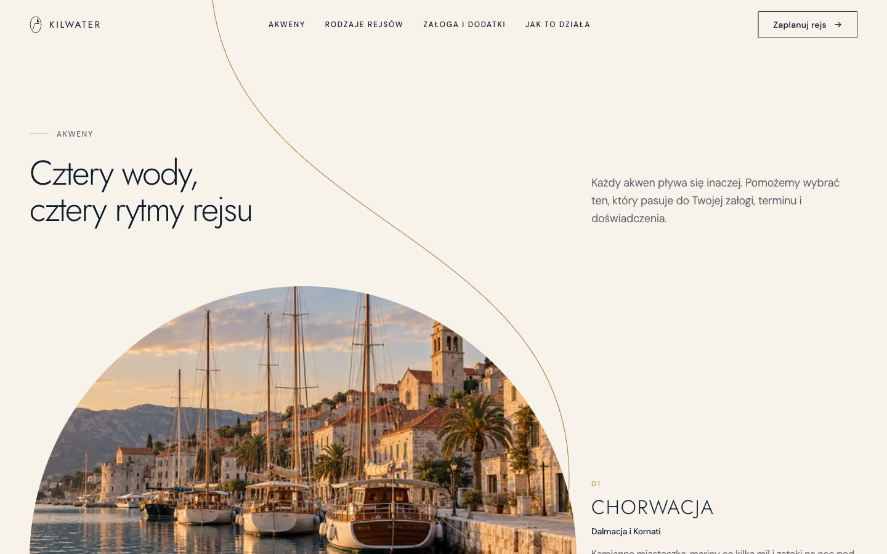 | 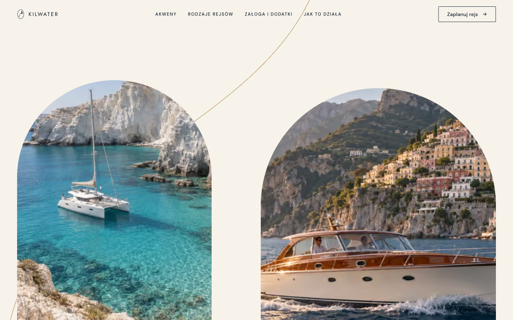 |

| Rodzaje rejsów | Dodatki na pokład |
|---|---|
| 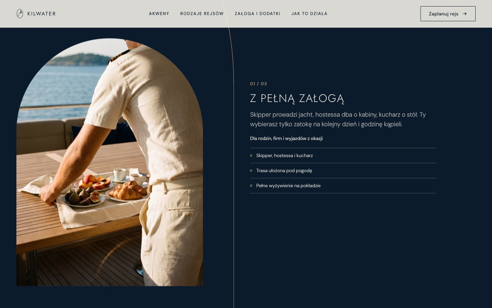 | 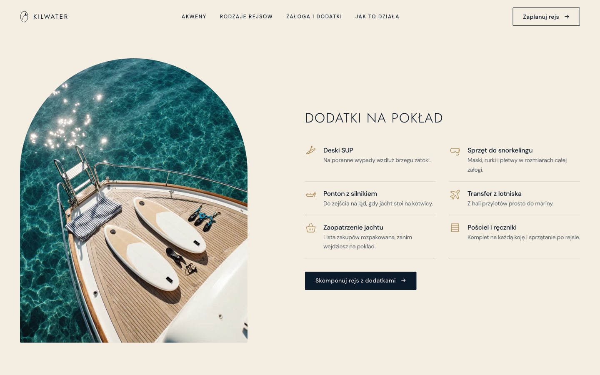 |

| Przykładowe trasy | Kalendarz sezonu |
|---|---|
| 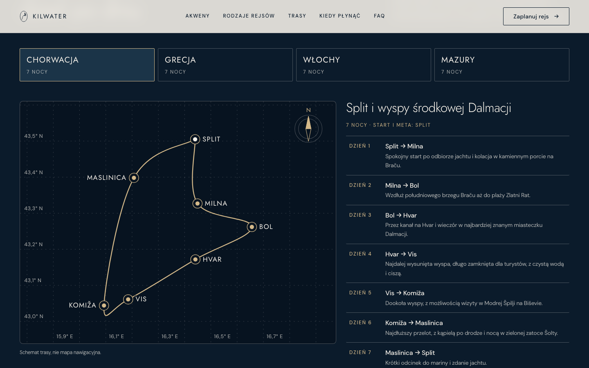 | 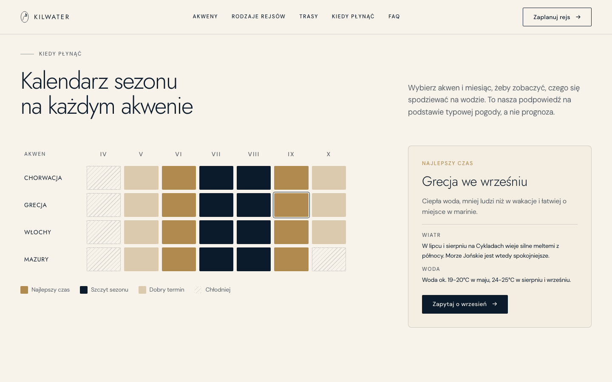 |

| FAQ i asystent | Trasa na telefonie |
|---|---|
| 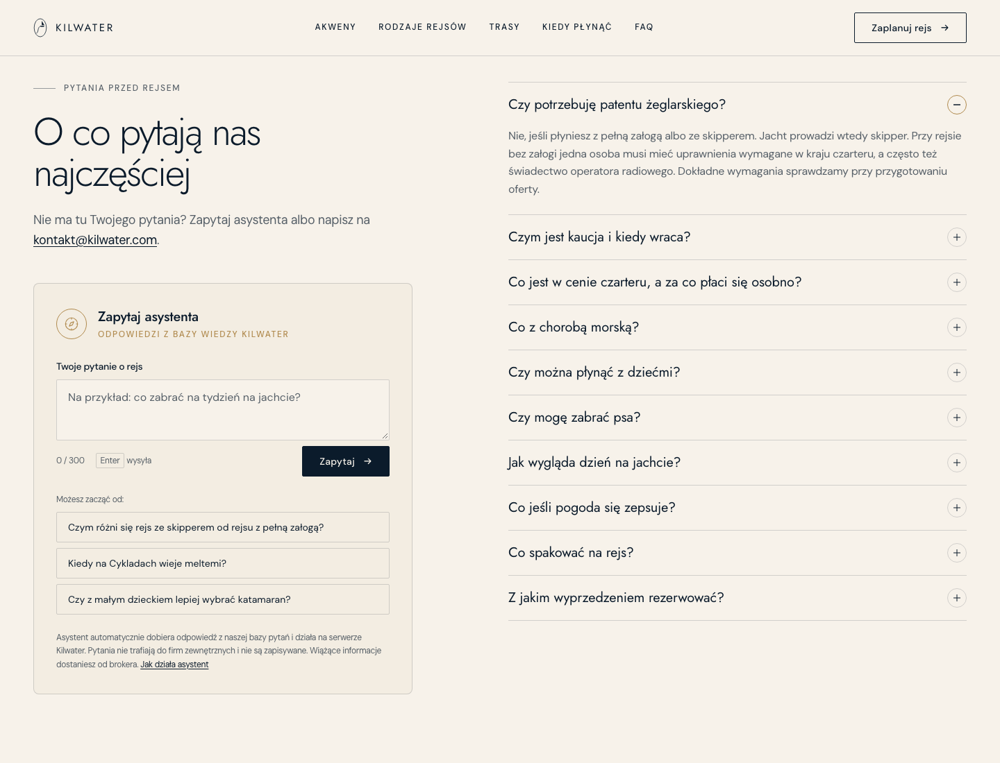 | 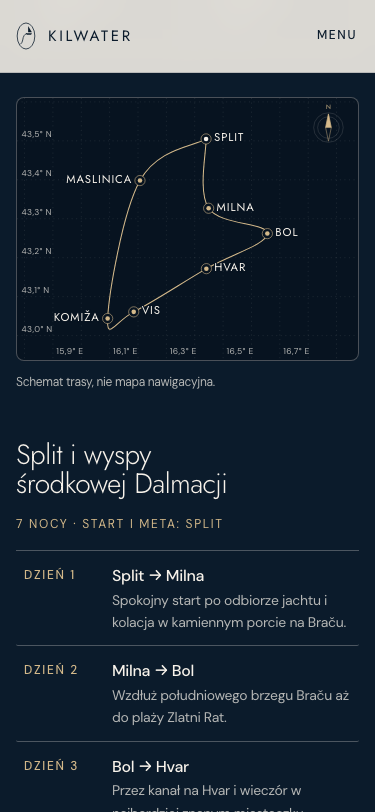 |

| Jak to działa | Stopka |
|---|---|
| 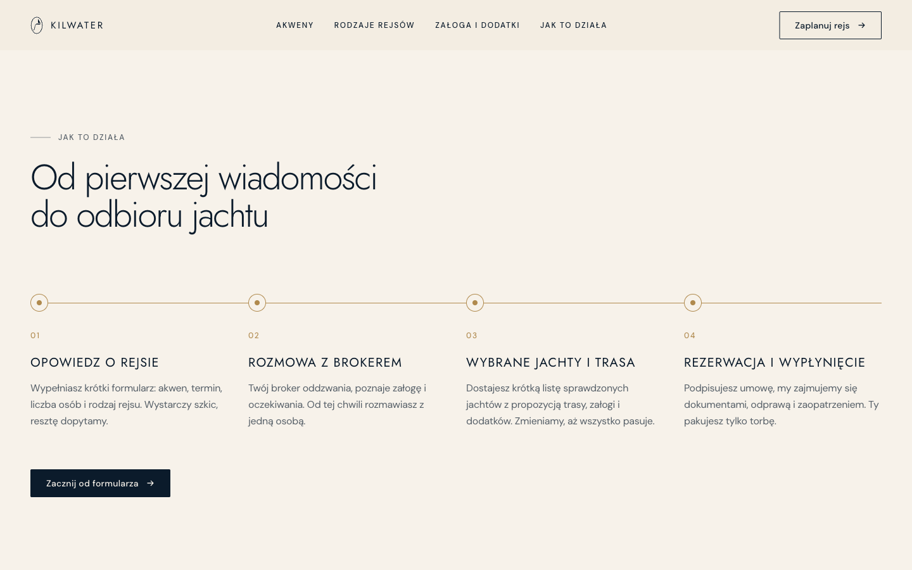 | 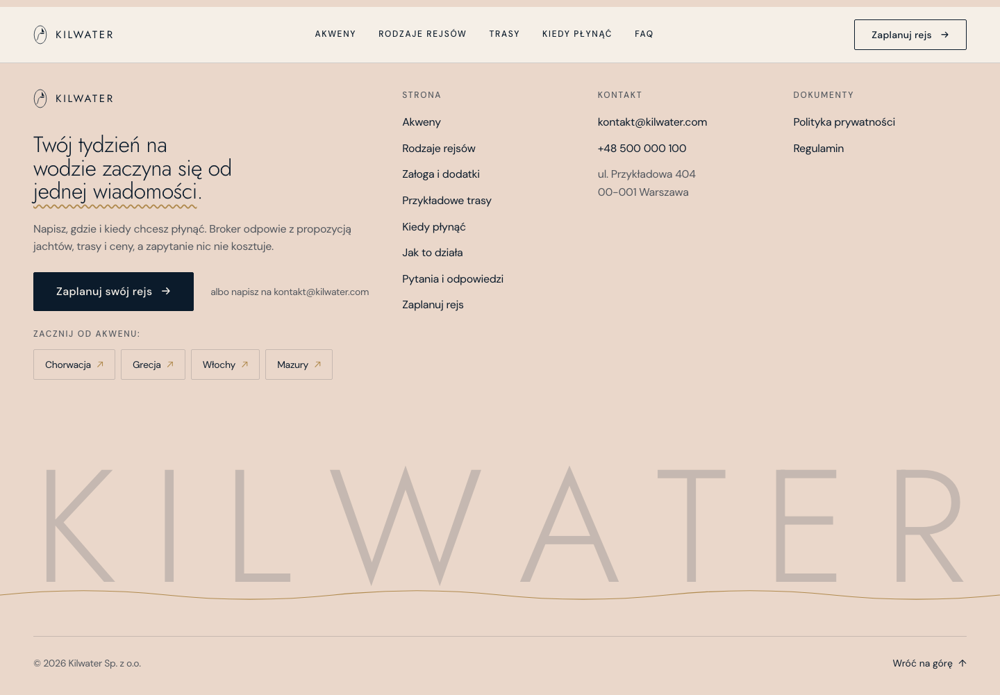 |

| Formularz zapytania | Formularz z błędami |
|---|---|
| 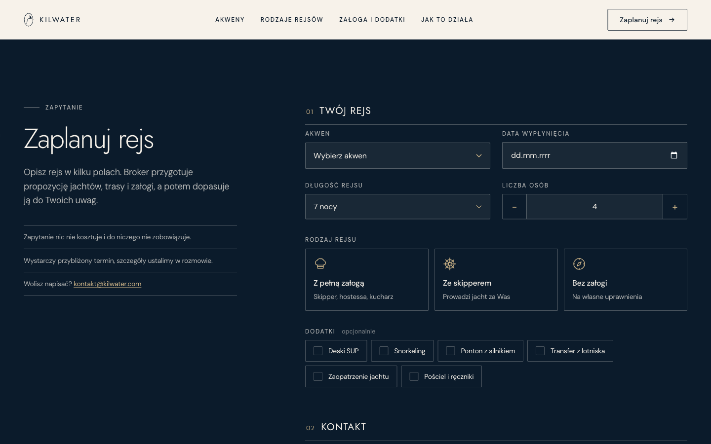 | 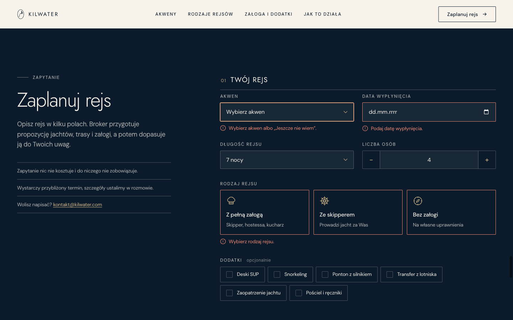 |

| Strona 404 | Polityka prywatności |
|---|---|
| 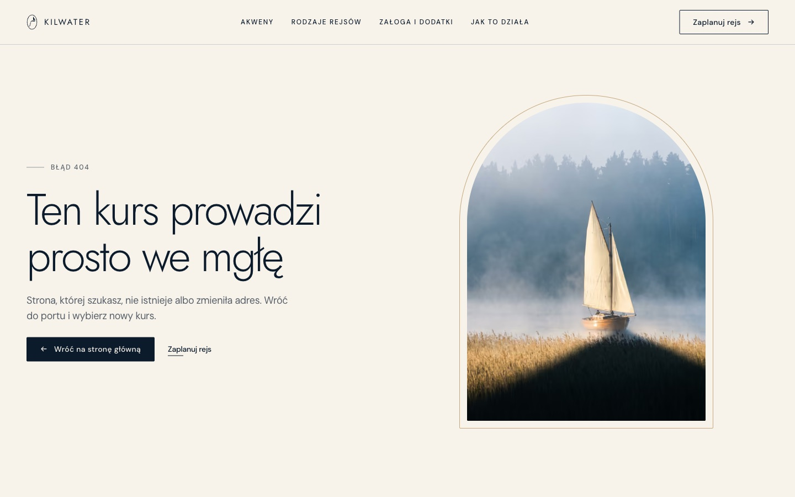 | 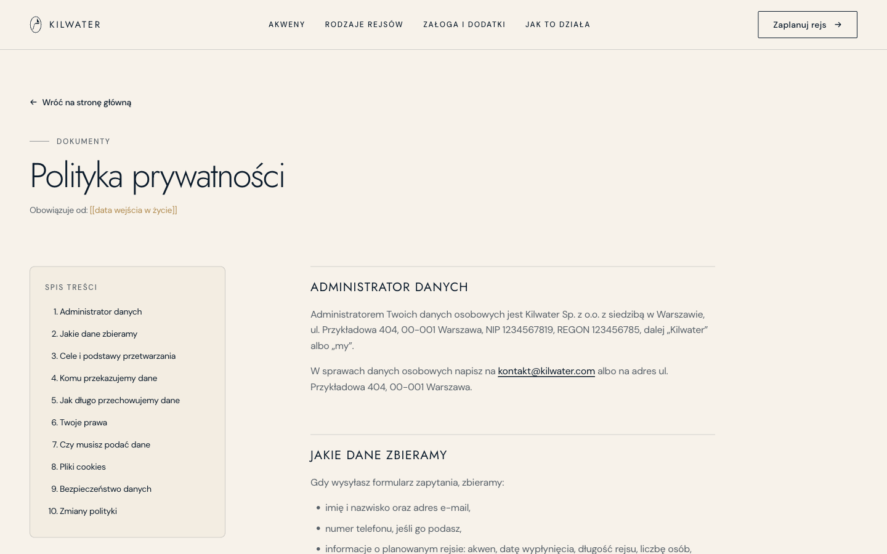 |

### Telefon

| Hero | Menu |
|---|---|
| 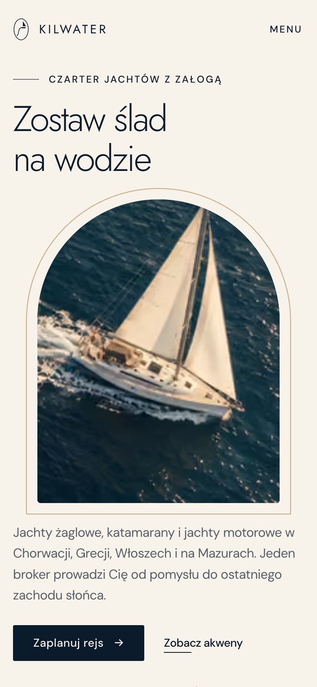 | 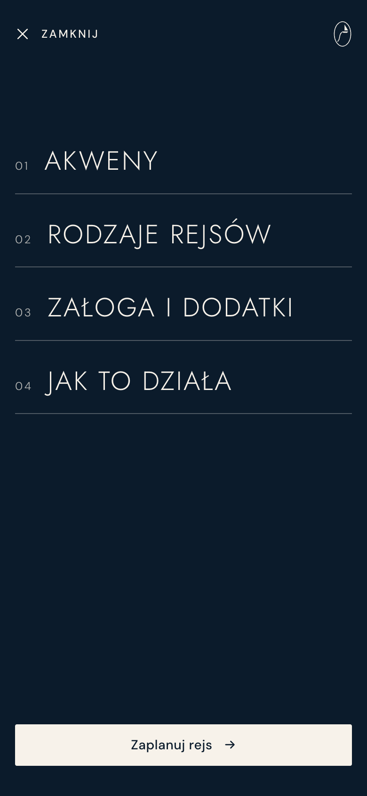 |

Zrzuty pokazują stan końcowy animacji. Dane w formularzu są
przykładowe.

## Uruchomienie

Wymagany Node.js 22.23.4 lub nowszy (wymóg Astro 7).

```bash
npm install
npm run assistant:model  # jednorazowo: model asystenta, ok. 560 MB do folderu models/
npm run dev              # http://localhost:4520
```

Wersja produkcyjna:

```bash
npm run build
HOST=0.0.0.0 PORT=8080 node ./dist/server/entry.mjs
```

| Skrypt | Co robi |
|---|---|
| `npm run dev` | Serwer deweloperski na porcie 4520. Zapytania z formularza trafiają do logu |
| `npm run build` | Build: statyczne strony w `dist/client`, serwer w `dist/server` |
| `npm run preview` | Podgląd buildu |
| `npm run assistant:model` | Pobiera model asystenta `Xenova/bge-m3` do `models/` (raz, także przy wdrożeniu) |
| `npm run test:e2e` | 38 testów Playwright na buildzie produkcyjnym (port 4521) |
| `npm run assistant:eval` | 48 pytań kontrolnych: parafrazy z bazy, pytania bliskie tematu bez odpowiedzi, pytania spoza tematu i filtr danych kontaktowych |
| `npm run brand:assets` | Generuje favicon (`.ico`, `.svg`, ikonę Apple) i obraz OG 1200x630 ze znaku logo |
| `npm run images:strip` | Usuwa metadane (EXIF, XMP, C2PA) ze zdjęć w `src/assets/photos`, `public` i `docs/screenshots` |

Astro 7 pozwala na jeden serwer deweloperski na projekt, dlatego testy budują wersję produkcyjną i uruchamiają
ją na osobnym porcie.

## Konfiguracja

Zmienne w `.env` (wzór w `.env.example`, sam `.env` jest w `.gitignore`).

| Zmienna | Opis |
|---|---|
| `RESEND_API_KEY` | Klucz API Resend. Tylko na serwerze |
| `INQUIRY_TO_EMAIL` | Adres, na który przychodzą zapytania, np. `kontakt@kilwater.com` |
| `INQUIRY_FROM_EMAIL` | Nadawca zweryfikowany w Resend, np. `Kilwater <zapytania@kilwater.com>` |
| `INQUIRY_DRY_RUN` | `1` = zapytanie tylko w logu serwera. Do testów, nigdy na produkcji |
| `ASSISTANT_RATE_LIMIT` | Ile pytań do asystenta na 10 minut z jednego adresu IP, domyślnie 20 |
| `HOST`, `PORT` | Adres i port serwera produkcyjnego |

Adres strony do canonical, Open Graph i sitemapy ustawia `site` w `astro.config.mjs` (`https://kilwater.com`).
Dane firmy w stopce i formularzu są w `src/data/company.ts`.

### Asystent (model lokalny)

Asystent nie korzysta z płatnego API. Model `Xenova/bge-m3` (ok. 560 MB, licencja MIT) działa w procesie Node
przez `@huggingface/transformers` i ONNX Runtime, bez karty graficznej.

1. Pobierz model: `npm run assistant:model`. Pliki trafiają do `models/` (w `.gitignore`), więc na serwerze
   uruchom to polecenie raz przy wdrożeniu. W działaniu serwer nie pobiera niczego z internetu.
2. Serwer uruchamiaj z katalogu projektu, bo model jest szukany w `./models`.
3. Pamięć: proces z wczytanym modelem zajmuje ok. 1 GB RAM, więc wystarczy serwer z 2 GB. Pierwsze pytanie po
   starcie wczytuje model przez kilka sekund. Strona uruchamia to wcześniej, gdy ktoś zbliża się do FAQ.
   Kolejne odpowiedzi trwają kilkadziesiąt milisekund.

Jak to działa:

| Krok | Co robi |
|---|---|
| Filtr na serwerze | Odrzuca puste i za długie pytania, linki, e-maile i numery telefonów |
| Baza wiedzy | `src/data/assistant-answers.ts`: FAQ z typowymi sformułowaniami (`alsoAsked` w `faq.ts`) oraz odpowiedzi składane z danych strony: akweny, sezon, trasy, rodzaje rejsów, załoga, dodatki, kontakt |
| Dopasowanie | Model zamienia pytanie na wektor i porównuje z każdym sformułowaniem w bazie |
| Odpowiedź | Gotowa odpowiedź i link, gdy podobieństwo wynosi co najmniej 0,80 albo co najmniej 0,70 z przewagą 0,04 nad drugą odpowiedzią. W pozostałych przypadkach od 0,64: „nie mam pewnej odpowiedzi” z podobnymi pytaniami. Poniżej: odesłanie na e-mail z treścią pytania |

Asystent nigdy nie pisze własnych zdań, pokazuje tylko teksty z bazy, więc nie da się go użyć do innych tematów.
Żeby nauczyć go nowego pytania, dopisz sformułowanie do `alsoAsked` albo nową pozycję w `assistant-answers.ts`
i uruchom `npm run assistant:eval`.

### Wysyłka e-mail (Resend)

1. Załóż konto na [resend.com](https://resend.com) i zweryfikuj domenę `kilwater.com` (rekordy DNS).
2. Utwórz klucz API z uprawnieniem tylko do wysyłki.
3. Uzupełnij `RESEND_API_KEY`, `INQUIRY_TO_EMAIL` i `INQUIRY_FROM_EMAIL` w `.env` na serwerze.
4. Wyślij zapytanie z formularza i sprawdź skrzynkę.

## Struktura

```
src/
  pages/            index, 404, polityka-prywatnosci.md, regulamin.md, sitemap.xml.ts
  pages/api/        zapytanie.ts - endpoint formularza, asystent.ts - endpoint asystenta
  components/       sekcje landingu (Hero, Destinations, CruiseTypes, CrewExtras, SampleRoutes,
                    SeasonCalendar, Process, Faq, Inquiry),
                    Voyage (linia fali), Nav, Footer, Logo, LineIcon
  layouts/          Base (meta, nawigacja, stopka), LegalLayout (dokumenty ze spisem treści)
  data/             company.ts, inquiry-options.ts, logo-mark.ts - jedno źródło danych i znaku logo,
                    offer.ts, routes.ts, seasons.ts, faq.ts - treść oferty, tras, kalendarza sezonu i FAQ,
                    assistant-answers.ts - baza odpowiedzi asystenta
  lib/              inquiry-schema.ts - walidacja zod, assistant.ts - model lokalny i dopasowanie pytań,
                    env.ts, rate-limit.ts
  scripts/          motion.ts (GSAP, Lenis, kotwice), reveal.ts (odsłanianie i paralaksa)
  styles/           tokens.css (kolory, typografia, odstępy), global.css
  assets/photos/    zdjęcia źródłowe, optymalizowane przy buildzie
public/             favicon, apple-touch-icon, og-image.jpg, robots.txt
scripts/            brand-assets.mjs, strip-image-metadata.mjs
tests/e2e/          formularz, API, strony i SEO, nawigacja, trasy, sezon, FAQ i asystent
tests/eval/         pytania kontrolne jakości odpowiedzi asystenta
models/             model asystenta pobierany przez npm run assistant:model (poza repozytorium)
docs/
  api-documentation.pdf / .html   dokumentacja endpointu
  screenshots/                    zrzuty ekranu używane w README
```

## Bezpieczeństwo

- Walidacja każdego pola na serwerze (zod `strictObject`), także gdy przeglądarka już je sprawdziła.
  Serwer przyjmuje tylko znane pola i nie bierze od klienta niczego poza treścią zapytania.
- Limit 5 zapytań na 10 minut z jednego IP, limit 10 000 bajtów treści, wymagany `Content-Type: application/json`.
- Pułapka na boty (`website`): bot dostaje `200`, a zapytanie nie jest przetwarzane.
- E-mail do brokera jest zwykłym tekstem, bez HTML z danych klienta. Odpowiedzi API nie zawierają szczegółów
  błędów ani stack trace.
- Klucz Resend tylko w `.env` na serwerze. Do przeglądarki nie trafia żaden sekret, baza odpowiedzi ani model,
  co sprawdza test e2e.
- Asystent: pytania przetwarzane wyłącznie na serwerze, odpowiedź renderowana jako tekst (`textContent`), w logach
  tylko rodzaj odpowiedzi, bez treści pytań. Limit 20 pytań na 10 minut z jednego IP chroni procesor.
- Zdjęcia nie mają metadanych (EXIF, XMP, C2PA). Pliki agentów AI, klucze i certyfikaty są w `.gitignore`.

Do zrobienia przy wdrożeniu: nagłówki bezpieczeństwa (CSP, HSTS, `Referrer-Policy`, `Permissions-Policy`,
`frame-ancestors`) na hostingu i Cloudflare Turnstile w formularzu. Limit żądań jest liczony w pamięci procesu,
więc przy kilku instancjach serwera trzeba go przenieść do wspólnego magazynu (np. Redis).

## Wydajność

Strona główna to statyczny HTML (12 KB po gzip), 8 KB CSS i 54 KB JavaScriptu po gzip, z czego większość to
GSAP i Lenis. Zdjęcia idą jako AVIF i WebP przez `srcset`, a poza pierwszym ekranem ładują się leniwie. Zdjęcie
w hero ma w AVIF 24-81 KB zamiast 2 MB w PNG. Fonty Jost i DM Sans są hostowane lokalnie (bez Google Fonts),
a font nagłówków ładuje się z wyprzedzeniem (`preload`).

## Zdjęcia i licencje - przed publikacją

Wszystkie zdjęcia są wygenerowane przez AI (ElevenLabs z modelem gpt-image-2.5, Gamma i FLUX.1 Krea na Hugging
Face). Nie przedstawiają prawdziwych jachtów ani osób. Metadane C2PA z informacją o pochodzeniu zostały usunięte.
Od sierpnia 2026 unijny AI Act (art. 50) wymaga oznaczania realistycznych treści wygenerowanych przez AI,
które przedstawiają prawdziwe miejsca. Przed publikacją sprawdź to z prawnikiem albo zastąp zdjęcia prawdziwymi
zdjęciami jachtów.

Fonty Jost i DM Sans są na licencji SIL Open Font License, więc można ich używać komercyjnie.

Dokumenty `/polityka-prywatnosci` i `/regulamin` to wzory. Przed publikacją uzupełnij pola `[[...]]` (KRS,
sąd rejestrowy, kapitał zakładowy, hosting, biuro rachunkowe, okresy przechowywania, data wejścia w życie)
i daj je do sprawdzenia prawnikowi. Dane firmy w obecnej wersji są przykładowe.

## Dokumentacja

- [`docs/api-documentation.pdf`](docs/api-documentation.pdf) - endpoint `POST /api/zapytanie`: pola,
  wartości, przykłady żądań i odpowiedzi, kody błędów, wysyłka e-mail.
- [`docs/api-documentation.html`](docs/api-documentation.html) - ta sama dokumentacja w HTML.

## Licencja

[MIT](LICENSE) © 2026 Szymon Kaczmarczyk
